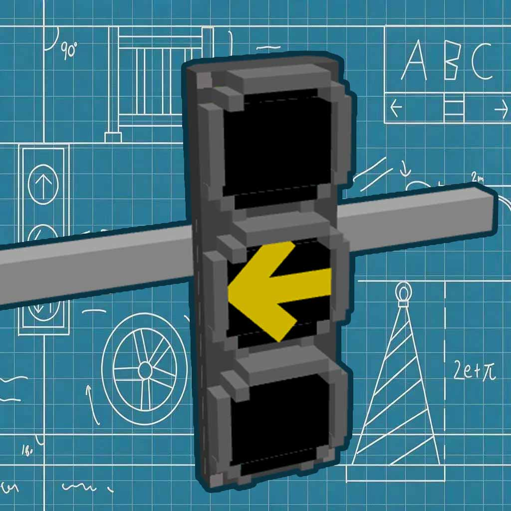

# JINZAI Traffic Lights



## English

Mod version: 2.0.46 on all four platforms.

| Minecraft | Loaders | Java | Source project |
|---|---|---|---|
| 1.20.1 | Fabric / Forge | 17 | Repository root |
| 1.21.1 | Fabric / NeoForge | 21 | [versions/1.21.1](versions/1.21.1/README.md) |

This mod received art assets and funding support from "Crzay津仔", with technical implementation and production by "QiZhang". Copyright in the art assets belongs to "Crzay津仔"; copyright in the mod code and configuration belongs to "QiZhang".

The project's original code, configuration, documentation, models, textures and other artwork are licensed under the [MIT License](LICENSE). Copyright ownership and credits remain unchanged; third-party components retain their respective licenses.

### Introduction

JINZAI Traffic Lights is a decorative expansion mod for city building. Version 2.0.46 keeps all 234 existing registry IDs and adds all 27 phase-five blocks, for 261 blocks in total:

- 65 traffic-light frames and frame components.
- 63 static indicators and decorative lights, plus 31 animated signal blocks.
- 88 poles and pole components.
- 14 illuminated, pass-through traffic-light accessories.

Phase five adds 11 height-restriction pole components and 16 animated indicators. Each new animated texture contains 144 frames at 10 ticks per frame, for a 72-second loop. All additions use the four established creative tabs. Every existing ID, name, model, texture, animation and collision box from 2.0.45 is preserved.

Every new phase-five model, every phase-four addition, and the three previously replaced frame models use one axis-aligned bounding box enclosing the complete placed model volume. Unmodified older models retain their existing selection and collision behavior. Indicators and accessories remain illuminated and have no physical collision; their bounding boxes are used for selection.

The 31 animated signals use vanilla synchronized texture animation at 2 FPS. These are decorative animations: independent per-block timing, functional countdowns, automatic traffic control and redstone-controlled signal logic are not included.

The existing corrections that fit and center 26 older inventory icons within their slots are retained. These corrections affect only the GUI display transform; supplied art, placed models, textures, animation and collision boxes are unchanged. The explicit corrections are maintained in `tools/gui_display_overrides.json`.

The mod provides localized block and creative-tab names in 13 languages and follows the language selected in Minecraft: English, Simplified Chinese, Spanish, Hindi, Arabic, French, Brazilian Portuguese, Russian, Indonesian, German, Japanese, Turkish and Korean. Items intentionally show only their localized names; no additional item tooltip notes are added.

### Installation

The following Fabric / Forge instructions are for Minecraft 1.20.1. For Minecraft 1.21.1, use Java 21 and either Fabric Loader 0.17.2 with Fabric API 0.116.15+1.21.1, or NeoForge 21.1.248; both require Architectury API 13.0.8 (13.x). See the [1.21.1 project](versions/1.21.1/README.md) for the corresponding JAR names. Dependencies must match both Minecraft and the loader.

Fabric:

1. Install Fabric Loader 0.17.2 or a newer compatible release for Minecraft 1.20.1.
2. Separately install Fabric API 0.92.6+1.20.1 and Architectury API 9.0.6 through versions earlier than 10.0.0. Testing used Architectury API 9.2.14; dependencies are not bundled in the release JARs.
3. Put `JINZAI_Trafficlights-Fabric-1.20.1-2.0.46.jar` in the instance's `mods` folder.

Forge:

1. Install Forge 47.x for Minecraft 1.20.1.
2. Separately install Architectury API 9.0.6 through versions earlier than 10.0.0. Testing used Architectury API 9.2.14; dependencies are not bundled in the release JARs.
3. Put `JINZAI_Trafficlights-Forge-1.20.1-2.0.46.jar` in the instance's `mods` folder.

Remove older copies of this mod before launching so two JARs with the same mod ID are not loaded together.

### Build and verify

```powershell
.\gradlew.bat clean build
```

This builds Minecraft 1.20.1 using JDK 17. To build Minecraft 1.21.1, select JDK 21, change to `versions/1.21.1`, then run that project's `gradlew.bat clean build`.

The public source retains the original art files and all pre-generated runtime
resources. Private non-build documents and workbooks are not part of the public
source package. The resource generator and full art audit remain in `tools/`
for development reference and require separately maintained private inputs;
they are not public-package acceptance commands.

Release JARs:

```text
fabric/build/libs/JINZAI_Trafficlights-Fabric-1.20.1-2.0.46.jar
forge/build/libs/JINZAI_Trafficlights-Forge-1.20.1-2.0.46.jar
```

---

# 津仔的交通灯

## 中文

四端模组版本统一为2.0.46。

| Minecraft | 加载器 | Java | 源码工程 |
|---|---|---|---|
| 1.20.1 | Fabric / Forge | 17 | 仓库根目录 |
| 1.21.1 | Fabric / NeoForge | 21 | [versions/1.21.1](versions/1.21.1/README.md) |

本模组由"Crzay津仔"提供美术与资金支持，"QiZhang"提供技术实现与制作。美术素材版权归 "Crzay津仔"所有，模组代码/配置版权归"QiZhang"所有。

本项目自身的代码、配置、文档、模型、贴图及其他美术素材采用 [MIT 许可证](LICENSE)。版权归属和署名保持不变；第三方组件保留各自的许可证。

### 模组介绍

津仔的交通灯是一个面向城建装饰的扩展模组。2.0.46保留已有234个注册ID，并加入五期全部27个新方块，总计261个：

- 65个红绿灯框架与框架部件。
- 63个静态指示灯与照明装饰，以及31个动态指示灯方块。
- 88个杆子与杆件部件。
- 14个发光且可穿透的交通灯附属。

五期新增11个限高杆件和16个动态指示灯，沿用原有4个创造标签页。新动态贴图均为144帧、每帧10 tick，完整循环72秒。2.0.45的全部旧注册ID、名称、模型、贴图、动画和碰撞箱均保留。

五期全部新模型、四期全部新增模型和此前3个替换框架模型均使用一个覆盖放置后完整体积的轴对齐外包箱。未修改的旧模型保留原有选框与碰撞行为。指示灯和附属保持发光、没有物理碰撞，外包箱用于准星选中。

31个动态指示灯仍使用原版同步纹理动画，以2 FPS播放，属于装饰动画，不包含每个方块独立计时、功能性倒计时、自动交通控制或红石控制信号逻辑。

保留此前26个旧物品图标的缩小和居中修复，避免图标跨出物品格。仅修改GUI展示变换，原始美术、放置后的模型、贴图、动画和碰撞箱均保持原样。明确的展示覆盖配置保存在`tools/gui_display_overrides.json`。

模组提供13种语言的方块名称和创造标签页名称，并根据Minecraft当前语言自动切换：英语、简体中文、西班牙语、印地语、阿拉伯语、法语、巴西葡萄牙语、俄语、印度尼西亚语、德语、日语、土耳其语和韩语。物品按要求只显示本地化名称，不额外添加物品备注提示。

### 安装

下方Fabric / Forge步骤适用于Minecraft 1.20.1。Minecraft 1.21.1需要Java 21，可选择Fabric Loader 0.17.2与Fabric API 0.116.15+1.21.1，或NeoForge 21.1.248；两端均需Architectury API 13.0.8（13.x）。对应JAR名称见[1.21.1工程说明](versions/1.21.1/README.md)，依赖文件必须匹配Minecraft版本及加载器。

Fabric：

1. 安装Minecraft 1.20.1对应的Fabric Loader 0.17.2或更高兼容版本。
2. 另行安装Fabric API 0.92.6+1.20.1和Architectury API 9.0.6至低于10.0.0的版本；测试使用Architectury API 9.2.14，Release JAR不内置这些依赖。
3. 将`JINZAI_Trafficlights-Fabric-1.20.1-2.0.46.jar`放入实例的`mods`文件夹。

Forge：

1. 安装Minecraft 1.20.1对应的Forge 47.x。
2. 另行安装Architectury API 9.0.6至低于10.0.0的版本；测试使用Architectury API 9.2.14，Release JAR不内置这些依赖。
3. 将`JINZAI_Trafficlights-Forge-1.20.1-2.0.46.jar`放入实例的`mods`文件夹。

启动前请移除本模组旧版本，避免同时加载两个具有相同模组ID的JAR。

### 构建与校验

```powershell
.\gradlew.bat clean build
```

上述命令在仓库根目录使用JDK 17构建Minecraft 1.20.1。构建Minecraft 1.21.1时，切换至JDK 21并进入`versions/1.21.1`，再运行该目录的`gradlew.bat clean build`。

公开源码保留原始美术文件和全部已生成运行资源。私有且不参与构建的说明文档与
工作表不属于公开源码包。`tools/`中的资源生成器和完整美术审计工具作为开发参考
保留，运行时需要另行维护私有输入，不作为公开源码包的验收命令。

正式JAR：

```text
fabric/build/libs/JINZAI_Trafficlights-Fabric-1.20.1-2.0.46.jar
forge/build/libs/JINZAI_Trafficlights-Forge-1.20.1-2.0.46.jar
```
